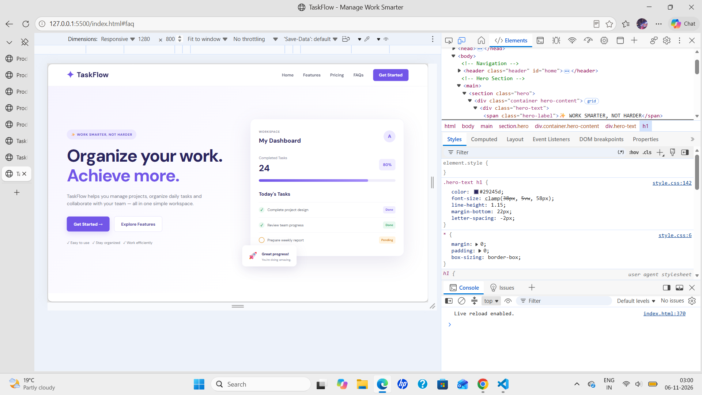
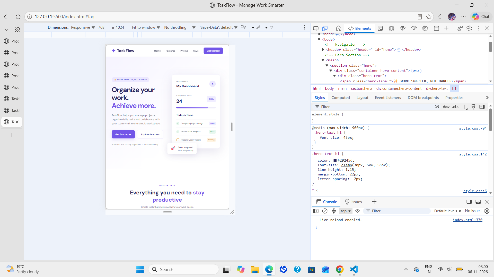
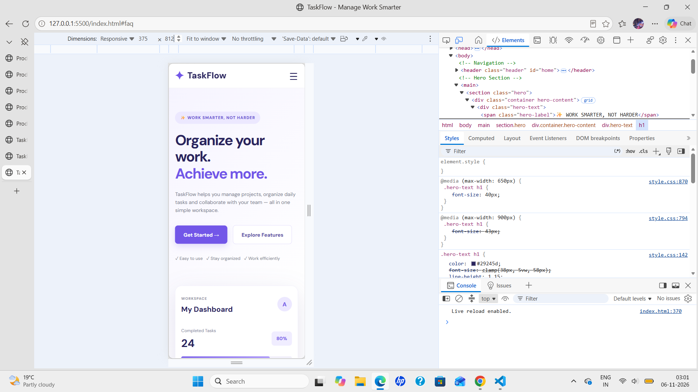

# TaskFlow – Product Landing Page

A modern, responsive product landing page for TaskFlow, a fictional productivity and task management platform. The website presents product features, pricing plans, frequently asked questions, and clear call-to-action sections.

## 🌐 Live Demo

Coming soon – GitHub Pages deployment.

## ✨ Features

- Modern and responsive landing page design.
- Sticky navigation bar.
- Mobile-friendly hamburger navigation menu.
- Hero section with call-to-action buttons.
- Product features section.
- Three pricing plans: Starter, Professional, and Enterprise.
- Monthly and annual pricing toggle.
- Interactive FAQ section using expandable questions.
- Responsive layouts for desktop, tablet, and mobile devices.
- Smooth navigation between page sections.

## 🛠️ Technologies Used

- HTML5 – Website structure.
- CSS3 – Styling, layouts, animations, and responsiveness.
- JavaScript – Mobile navigation and dynamic pricing toggle.
- Google Fonts – DM Sans typography.

## 📁 Project Structure

```text
Product-Landing-Page/
│
├── index.html
├── README.md
│
├── css/
│   └── style.css
│
├── js/
│   └── script.js
│
└── screenshots/
    ├── desktop1.png
    ├── tablet1.png
    └── mobile1.png
```

## 📸 Screenshots

### Desktop View


### Tablet View


### Mobile View


## 🚀 How to Run Locally

1. Clone this repository:

   ```bash
   git clone https://github.com/aasthasharma71/product-landing-page.git
   ```

2. Open the project folder.

3. Open `index.html` in your browser or use the VS Code Live Server extension.

## 🧪 Testing

The website was tested on:

- Desktop (1280 × 800)
- Tablet (768 × 1024)
- Mobile (375 × 812)

Interactive features tested:

- Mobile navigation menu.
- Monthly and annual pricing switch.
- FAQ expand and collapse.
- Navigation links.
- Responsive layouts.

## 🔮 Future Improvements

- Add user authentication.
- Connect pricing plans to a backend.
- Integrate a functional contact form.
- Add real product screenshots and customer testimonials.

## 👩‍💻 Author

**Aastha Sharma**

B.Tech Computer Science and Engineering Student


